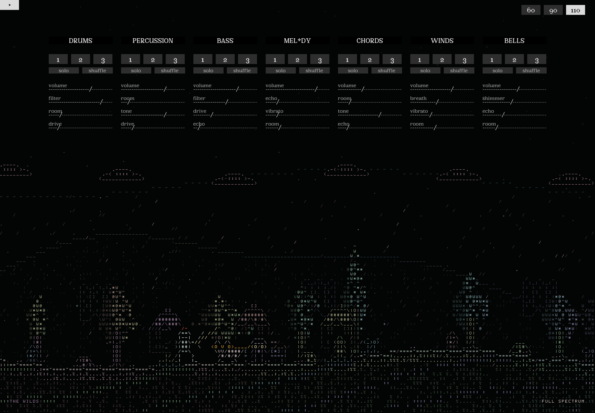

# WEBsynth — музыка, которая меняет мир

Браузерный синтезатор с семью музыкальными каналами и живым ASCII-миром. Собираешь музыку из паттернов, меняешь эффекты — а рыцарь идёт через лес, спускается в шахту, встречает дракона или пережидает тишину у костра.

Проект развивался в диалоге с ChatGPT и Codex: от музыкального инструмента до визуального путешествия. Ниже — как всё работает и какие запросы помогли прийти к текущему результату.



**Версия 3.0.0 · Web Audio API · JavaScript · HTML Canvas · HTML/CSS**

[Запуск](#быстрый-запуск) · [Управление](#как-играть) · [Визуальный мир](#как-музыка-управляет-миром) · [Работа с промптами](#как-я-добивался-результата-через-промпты) · [Разработка](#разработка)

## Быстрый запуск

1. Скачай репозиторий: **Code → Download ZIP**, распакуй архив.
2. Открой [dist/index.html](dist/index.html) в современном браузере.
3. Выбери паттерн **1, 2 или 3** хотя бы у одного канала и нажми **Play** в левом верхнем углу.

Изначально все каналы выключены. Для первого знакомства включи по одному паттерну во всех семи каналах: сцена постепенно наберёт цвет, а музыка запустит путешествие.

Установка пакетов и подключение к сети для локального запуска не нужны. Если удобнее открывать через локальный сервер:

```sh
python3 -m http.server 8000 --directory dist
```

Затем открой `http://127.0.0.1:8000/`. Папка `dist/` содержит готовое приложение и подходит для статического хостинга.

## Как играть

| Управление | Что делает |
| --- | --- |
| **Play / Stop** | Запускает и останавливает музыку. Повторный Play начинает композицию с первого такта. |
| **1 / 2 / 3** | Выбирает паттерн канала. Повторный выбор активного паттерна выключает канал. Во время игры переключение происходит на границе следующего такта. |
| **solo** | Оставляет слышимым один канал. Повторное нажатие возвращает общий микс. |
| **shuffle** | Сдвигает ритмические позиции нот, сохраняя музыкальный материал. Повторное нажатие возвращает исходный рисунок. |
| **volume** | Меняет громкость канала и его вклад в визуальный мир. |
| **Ползунки `-----/-----`** | Управляют аудиопараметрами мышью, касанием и стрелками клавиатуры при фокусе. |
| **60 / 90 / 110** | Выбирает темп в BPM. По умолчанию — 110. |

В каждом паттерне четыре такта по 16 шестнадцатых шагов. Тональный материал — D minor.

### Семь каналов

У каждого канала есть громкость и три дополнительных параметра. В интерфейсе реверберация обозначена как `room`, задержка — как `echo`.

| Канал | Звучание | Параметры после volume |
| --- | --- | --- |
| **Drums** | Kick, rim, hi-hat; прямые, ломаные и разреженные ритмы | filter · room · drive |
| **Percussion** | Низкие и краевые удары, металлические акценты | room · tone · drive |
| **Bass** | Три басовых рисунка | filter · drive · echo |
| **Melody** | Электронный лид; в интерфейсе — `Mel*dy` | echo · vibrato · room |
| **Chords** | Аккордовые пульсации, арпеджио и тихий фон | room · tone · echo |
| **Winds** | Синтезированный духовой тембр с дыханием | breath · vibrato · room |
| **Bells** | Колокольчики, cowbell и смешанный рисунок | shimmer · echo · room |

Звук создаётся средствами Web Audio API. Записей настоящих инструментов здесь нет. `room` и `echo` регулируют посылы в общие эффекты; `drive` добавляет насыщение. Дыхание, vibrato и обертоны меняют следующие ноты, а громкость, фильтры и посылы регулируются плавно во время игры.

## Как музыка управляет миром

Визуальный слой получает от секвенсора текущий музыкальный шаг, состояние каналов и значения эффектов. Учитывается слышимый состав: Solo и нулевая громкость исключают заглушённые каналы из визуального микса. Пауза между отдельными нотами не считается тишиной.

| Что меняешь | Что происходит на экране |
| --- | --- |
| Добавляешь каналы | Мир становится насыщеннее; полный состав запускает цветную волну. |
| volume | Меняются скорость движения и интенсивность сцены. |
| filter / tone | Меняются яркость и читаемость деталей. |
| room | Меняются небесные слои, частицы и вероятность маршрута на высоте. |
| echo | За героем появляются повторные силуэты. |
| drive | Усиливаются трещины, пламя и вероятность маршрута через шахту. |
| vibrato / breath | Покачиваются деревья и меняется движение частиц. |
| shimmer | Мерцают звёзды и появляются дополнительные искры. |

### Что попробовать

- **Дракон:** включи Drums + Bass + Winds, оставь исходную громкость и выключи Solo. Встреча возможна после первых нескольких тактов на поверхности, вне других эпизодов и переходов. Рыцарь защищается щитом и отвечает из лука; повторный прилёт — не раньше чем через 48 секунд.
- **Дождь:** Drums + Bass + Winds **или** Drums + Bass + Percussion.
- **Солнце:** Melody + Bells. Если звучат обе погодные комбинации, дождь и солнце чередуются музыкальными фразами. Состав проверяется раз в четыре такта, переходы плавные; под землёй погода не рисуется.
- **Разные маршруты:** дай музыке поиграть. Через несколько тактов герой выбирает продолжение пути: бас, ударные и Drive повышают вероятность шахты, Winds, Bells и реверберация — мостов. Начатый переход по лестнице всегда завершается.
- **Костёр:** выключи все паттерны, убери всю громкость или нажми Stop. Рыцарь разобьёт лагерь. Верни музыку — и он продолжит путь.

По дороге встречаются гоблины, слизни, волки, пауки и летучие мыши. В шахте появляется факел, в деревне — короткая торговля с жителем. Это автоматические визуальные эпизоды: управление персонажем, урон, инвентарь и сохранения не предусмотрены. Костёр, дождь и бой не добавляют звуков к композиции.

### Почему ASCII остаётся чётким

Мир рисуется на полноэкранном **HTML Canvas** за интерфейсом. Рыцарь, деревья, дома и дракон собираются из символов собственного растрового алфавита **5×7** в клетках **8×11**. Отрисовка учитывает `devicePixelRatio` и использует целые физические блоки без сглаживания, blur и glow.

В интерфейсе используется отдельный шрифт **Argent Pixel CF**. Визуал обновляется с ограничением до 30 кадров в секунду; в скрытой вкладке отрисовка приостанавливается. Системный режим уменьшенного движения отключает перемещение и активные эпизоды.

## Как я добивался результата через промпты

Работа шла итерациями: идея → первая версия → просмотр → конкретная правка → проверка. Вместе с текстом использовались композиционный референс, актуальная папка проекта и макет Figma.

**О цитатах:** ниже — дословные фрагменты моих запросов из истории разработки. В каждом блоке приведена только часть сообщения; пояснения рядом описывают реализованный результат. Разбор охватывает расширение музыкального инструмента и последующую работу над визуальным миром.

### 1. Расширить музыкальную основу через понятные действия

> крч го добавим сделаем чтобы у каждого звука было по 3 паттерна разных. добавим духовые, типа флейта или чет такое и го добавим колокольчики/коубелы хз.

> и еще у каждого звука сделай кнопку которая отключает все остальные звуки кроме этого

Следующим запросом управление было расширено:

> го сделаем еще у каждого звука кнопку перемешки паттерна и добавим к каждому звуку еще ползунки эффектов которые логически подходят типу звука

В результате инструмент получил семь каналов, по три паттерна, Solo, Shuffle и набор эффектов для каждого тембра. В той же постановке было изменение BPM; позднее оно получило три фиксированных пресета в интерфейсе.

**Приём:** описывать действие с позиции пользователя. Для Solo оказалось достаточно сформулировать, что кнопка должна оставить слышимым только выбранный звук. Пожелание духового тембра реализовано синтезом; запись настоящей флейты в проект не добавлялась.

### 2. Сначала — идея и объём первой версии

> мне надо что то супер простое. Что можно буквально за вечер-два сделать. У меня уже есть музон.

> где чувачок может бегать и от интенсивности музыки зависит ландшафт и че этот чел делает.

Так появилась основа: музыкальный инструмент уже есть, к нему нужен реагирующий мир и герой. Срок и масштаб задали отправную точку для V1. В дальнейшей постановке отдельно закрепили ограничение: сохранить существующую аудиосистему.

**Приём:** обозначить, что уже готово, какой новый слой нужен и сколько хочется сделать за первый заход. Маршруты, торговля и погода появились позже, после просмотра работающей основы.

### 3. Описать композицию и качество изображения

> основное действие происходит в нижней части экрана, элементы интерфейса сверху

> Главное еще чтобы качество было хорошим у аскиайа. Чтобы маленькие были детаи неразмыленные, чтобы детализированность хорошей была.

К запросу был приложен визуальный референс. В результате Canvas занимает весь экран, действие сосредоточено снизу, а управление остаётся поверх сцены. Крупные события могут заходить в верхнюю зону. После следующей итерации для чёткости появился собственный растровый набор символов.

**Приём:** разложить желаемое изображение на расположение, масштаб деталей, резкость и отношение графики к кнопкам. Эти требования можно проверить на экране.

### 4. После просмотра — назвать, чего не хватает

> а че оно такое топорное? можно ли сделать как то натуральнее, чтобы шрифт пиксельный использовался в основе аскиай.

> Чтобы от изменения крутилок — эффектов тоже чет менялось. Мб добавить нелинейность. Чтобы чел не просто шел вперед, а в шахту спускался или наоборот куда то забирался.

> Сначала дай обратку по моим предложениям скажи че ок че нет, где можно еще улучшить и потом рванем делать с тобой

Здесь оценка первой версии стала набором задач: пиксельные символы, реакции на эффекты, разные маршруты и более живые события. Перед реализацией состоялся разбор объёма. Затем в мир добавили поверхность, шахту, высоту, цветную кульминацию и законченный эпизод с драконом.

**Приём:** соединить впечатление от результата с конкретными изменениями и отдельно запросить разбор реализуемости. Переходы получили память: изменение музыки влияет на следующее решение, а уже начатая лестница завершается.

### 5. Задать персонажу поведение через условия

> А го сделаем чувака чтобы он был типа рыцарем. в шлеме, доспехах, с мечом и луком.

> И еще го сделаем когда звуки отключаются все то он садится и костер разводит

У героя появились узнаваемые атрибуты и состояния: путь, бой, защита, стрельба и отдых. Условие «все звуки отключены» превратилось в отдельное поведение лагеря. При реализации учитываются и выключенные паттерны, и нулевая громкость, и Stop; короткие паузы между нотами лагерь не запускают.

**Приём:** описывать цепочку **условие → действие → возвращение к обычному состоянию**. Она задаёт поведение, которое можно воспроизвести и проверить.

### 6. Для точного интерфейса — макет и перечень изменений

> ползунки сделать в виде, типа, чёрточек и слэшей, чтобы они были динамичны, чтобы их можно было двигать.

> сделай, короче, пресеты темпа, то есть оставь 60, 90 и 110. То есть три кнопки, ползунок убери

В запросе были ссылки на ряд инструментов и отдельную карточку в Figma, требования к шрифту, позиции Play/Stop и список лишних подписей. Следующим коротким уточнением размер Play/Stop был приведён к размеру кнопок BPM.

**Приём:** использовать конкретные элементы макета вместе с перечнем изменений. Символьный ползунок получил рабочий range-контрол: внешний вид связан с тем же значением, которое управляет звуком.

### 7. Расширять мир после того, как основа работает

> а добавь чтобы он когда в шахту спускался у него факел в руках появлялся.

> Добавь дождь который иногда начинается в зависимости от комбинации или солнца наоборот

В том же запросе были новые монстры и торговля с жителями. В готовой версии появились факел, пять типов противников, деревня и погодные комбинации каналов.

**Приём:** привязывать новые детали к существующим ситуациям: факел — к шахте, торговлю — к деревне, погоду — к составу музыки. Точные сочетания каналов и интервалы проверки погоды были выбраны при реализации: в исходном запросе этих чисел не было.

### Что помогало удерживать результат

- **Контекст:** актуальная папка, референс и конкретный макет задавали исходную точку.
- **Поэтапность:** следующая задача формулировалась после просмотра предыдущей версии.
- **Наблюдаемые условия:** «все каналы выключены → костёр» задаёт проверяемое поведение.
- **Границы изменений:** визуальный слой читает состояние музыки, аудиодвижок продолжает работать отдельно.
- **Проверка:** автоматические тесты дополнялись просмотром в браузере. При разработке отдельно проверялись Solo, нулевая громкость, Stop, переходы и уменьшенное движение.

В приложении нет вызовов ИИ во время игры. Здесь промпты использовались для разработки кода и уточнения поведения; звук и графика выполняются локально в браузере.

## Разработка

Для сборки и проверок нужен **Node.js 20+**. Внешних зависимостей нет, `npm install` не требуется.

```sh
node scripts/build.mjs   # скопировать src и ресурсы в dist
node scripts/check.mjs   # синтаксис, ресурсы и точное совпадение src/dist
node scripts/test.mjs    # проверки поведения
```

Доступны и команды `npm run build`, `npm run check`, `npm test`. Редактировать нужно `src/`: сборка полностью заменяет содержимое `dist/`.

```text
src/
├── index.html            # разметка и порядок загрузки
├── js/
│   ├── config.js         # каналы, параметры, музыкальная сетка
│   ├── music/            # события и паттерны семи инструментов
│   ├── audio/            # синтез, каналы, эффекты и аудиодвижок
│   ├── sequencer/        # время, темп и очереди переключений
│   ├── ui/               # карточки, ползунки и действия пользователя
│   ├── visual/           # состояние мира, пиксельный алфавит и Canvas
│   └── main.js           # запуск и жизненный цикл
├── styles/               # оформление и адаптивная раскладка
└── assets/               # локальные шрифты и изображения
dist/                     # готовое приложение
scripts/                  # сборка и проверки
tests/                    # тесты музыки, аудио, UI и мира
docs/                     # архитектура и аудит
```

Обычные `defer`-скрипты позволяют открыть приложение напрямую с диска. Аудиовремя задаётся `AudioContext.currentTime`; секвенсор планирует ноты заранее. Визуальный слой получает снимок уже звучащего шага через `visualFrame` и не отправляет аудиокоманды.

В текущем наборе **34 теста**. Они проверяют сохранность всех 21 паттерна, Shuffle, переключения на границе такта, Solo, темп, остановку источников, маршрутизацию эффектов, UI, маршруты, погоду, бой и лагерь. DOM и Web Audio имитируются, поэтому тесты не заменяют прослушивание и просмотр в настоящем браузере.

После изменений проверь вручную: Play → паттерны → Shuffle → Solo → эффекты и BPM → Stop → повторный Play. Для адаптивной раскладки — окно шириной 320–375 px.

Подробнее: [архитектура аудио и секвенсора](docs/architecture.md) · [аудит и рефакторинг](docs/code-review.md).

## Ограничения текущей версии

Экспорт аудио, MIDI, загрузка сэмплов и сохранение сессии пока не реализованы. Путешествие автоматическое, визуальные события декоративные. Общие хвосты реверберации и задержки после включения Solo могут затухать ещё некоторое время.
